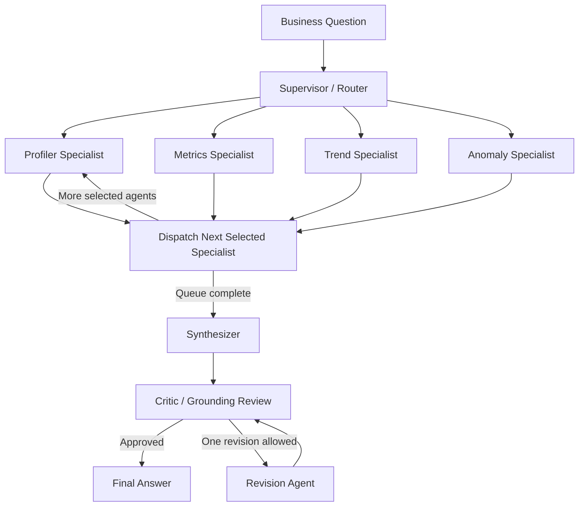

# Enterprise Analytics Agent

**A bounded, multi-agent analytics copilot:** a supervisor routes a business question to specialized analysts; specialists compute deterministic evidence; a synthesizer drafts a response; a critic checks grounding and can request one revision.

## Architecture



## Specialists
| Agent | Responsibilities | Deterministic evidence |
|---|---|---|
| Supervisor | Route to minimum relevant agents | Fixed specialist allow-list; fallback rules |
| Profiler | Dataset shape, types, missingness, numeric summaries | Pandas profiling functions |
| Metrics | Aggregations and comparisons | Grouped aggregation |
| Trends | Time-based summaries | Date parsing and monthly aggregation |
| Anomalies | Flag unusual numeric observations | IQR fences |
| Synthesizer | Combine evidence into a clear answer | Specialist findings |
| Critic | Check grounding, caveats and completeness | One bounded revision loop |

## Reliability and safety controls
- Fixed roles and finite workflow; no free-form agent spawning.
- Analytics are computed in Python before interpretation; LLMs don't calculate directly from raw rows.
- No arbitrary Python, shell, or SQL execution tool.
- Critic may request at most one revision.
- Fallback routing and evidence summaries operate if LLM calls fail.
- CSV data remains in the local app process; the app does not persist it.
- Use synthetic/public data only for the portfolio demo.

## Tech stack
Python 3.11+, Streamlit, pandas, LangGraph, LangChain OpenAI integration, pytest.

## Run locally
```bash
python -m venv .venv
# Windows: .venv\\Scripts\\activate
# macOS/Linux: source .venv/bin/activate
pip install -r requirements.txt
cp .env.example .env
```
Set the API key in `.env`:
```env
OPENAI_API_KEY=your_key_here
OPENAI_MODEL=gpt-4o-mini
```
Start:
```bash
streamlit run app.py
```

Without an API key, fallback routing and deterministic tools still run; LLM interpretation is replaced with evidence summaries.

## Example questions
- Compare revenue by region.
- What is the monthly revenue trend?
- Find unusual values in revenue.
- Profile the dataset and explain its quality.

## Testing
```bash
pytest -q
```

## Roadmap
- DuckDB read-only SQL analyst (query validation and statement/row limits)
- Metric dictionary retrieval (RAG)
- Evaluation set for tool selection, groundedness and answer quality
- LangGraph checkpointing and thread memory
- Token/cost telemetry
- Report export and additional visualizations

## License
MIT
