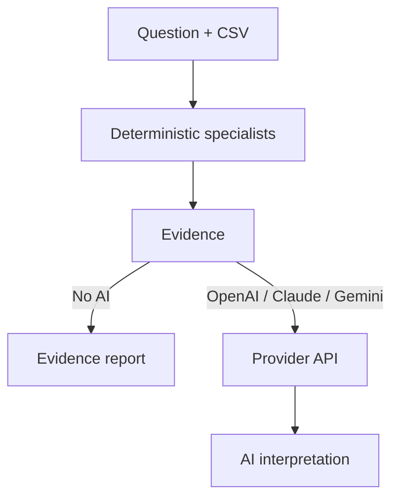

# Enterprise Analytics Agent

**A portfolio-ready analytics copilot with deterministic analytics and optional bring-your-own-provider AI.** Visitors can use the app without credentials or connect their own provider API key for natural-language interpretation of computed evidence.

## AI provider options (BYOK)

- OpenAI
- Anthropic Claude
- Google Gemini
- No AI (deterministic free demo)

Keys are entered in a password field, used for the current request, and are not intentionally persisted by this app. They are not written to files or logs. Provider API usage may incur costs. Consumer subscriptions (ChatGPT, Claude, Gemini apps) generally do not include API credits; users need provider API access and billing configured.

**Privacy behavior:** the provider receives the user's question and bounded deterministic specialist evidence only. The raw uploaded CSV is not intentionally sent to the AI provider. Users should avoid uploading sensitive data to a public demo.

## Architecture



## Features

- CSV upload and dataset profiling
- Deterministic routing to fixed specialist analytics
- Grouped metrics and monthly trends
- IQR anomaly scan
- Evidence and execution trace
- Optional BYO provider key: OpenAI, Claude, Gemini
- API key input is session-only; no app storage
- No arbitrary code execution

## Run locally

```bash
pip install -r requirements.txt
streamlit run app.py
```

## Safety and scope

- Specialist roles are fixed; no arbitrary agent spawning.
- Analytics are computed in Python before AI interpretation.
- AI receives the question and limited evidence, not the raw CSV.
- No arbitrary Python, shell, or SQL execution.
- Uploaded data is processed in-session; this is a portfolio demo, not a production security guarantee.
- This is exploratory decision support, not automated decision-making.

## Tests

```bash
pytest -q
```

## Roadmap

- Safe read-only SQL analytics
- Evaluation harness
- LangGraph checkpointing
- Tracing and cost telemetry
- Exportable reports

## License
MIT
