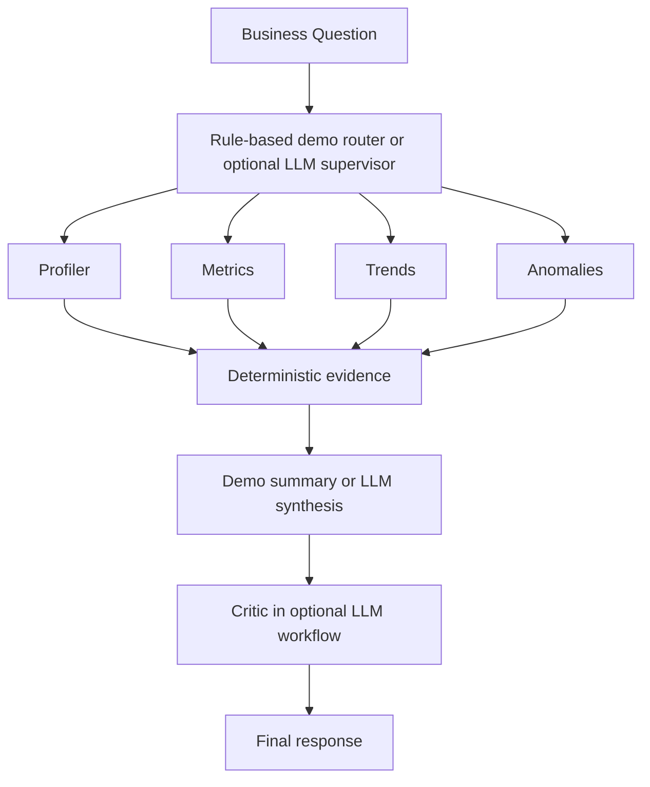

# Enterprise Analytics Agent

**A portfolio-ready analytics copilot with a deterministic, credential-free demo and an optional LLM-powered workflow.** A supervisor routes questions to fixed specialists; analytics are computed by bounded Python tools and displayed with evidence.

## Live demo

The app works without an OpenAI API key. The default demo mode uses deterministic routing and analytics, so visitors can try it immediately. LLM mode is optional and requires a personal API key configured in Streamlit Secrets.

## Architecture



## Demo mode (no API key)

- CSV upload and dataset profiling
- Rule-based routing to fixed specialist agents
- Grouped metrics and monthly trends
- IQR anomaly scanning
- Specialist evidence and execution trace
- No API key, external model calls, or arbitrary code execution

## Optional LLM mode

If you have an OpenAI API key, set it in Streamlit Cloud's app settings under **Secrets**:

```toml
OPENAI_API_KEY = "your-key"
OPENAI_MODEL = "gpt-4o-mini"
```

The LLM workflow adds model-based routing, interpretation, synthesis, and critic/revision. Do not commit credentials.

## Specialists

| Specialist | Responsibility | Deterministic tool |
|---|---|---|
| Profiler | Schema, missingness, summaries | `profile_data` |
| Metrics | Aggregations/comparisons | `grouped_metric` |
| Trends | Monthly patterns | `monthly_trend` |
| Anomalies | Unusual values | IQR fences |

## Safety and scope

- Fixed specialist roles; no agent spawning.
- Deterministic calculations are performed before interpretation.
- No arbitrary Python, shell, or SQL execution.
- Demo data is synthetic; uploaded data is processed in-session and not persisted by the app.
- This is an exploratory analytics tool, not a decision automation system.

## Run locally

```bash
python -m venv .venv
# Windows: .venv\\Scripts\\activate
# macOS/Linux: source .venv/bin/activate
pip install -r requirements.txt
streamlit run app.py
```

## Tests

```bash
pytest -q
```

## Roadmap

- Safe read-only DuckDB analyst
- Evaluation harness for routing and evidence quality
- LangGraph checkpointing and thread memory
- Tracing and cost telemetry
- Report export and visual insights

## License
MIT
